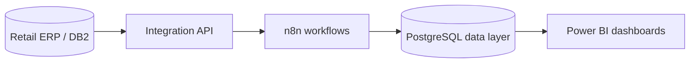

# Retail Business Intelligence & Data Integration
### ERP Data Pipelines · PostgreSQL · Power BI

> **Project showcase** — Turning operational records into decisions

**The problem.** Retail analytics are hard when sales, purchasing, stock, and product classifications live in an ERP but management needs a consistent cross-functional view.

**The solution.** A reporting pipeline that extracts operational data through an integration service, orchestrates transformations, stores reporting-ready data in PostgreSQL, and delivers interactive Power BI analysis.

## Architecture

## Analysis areas

| Area | Analytics supported |
| --- | --- |
| **Sales and purchasing** | Compare sold and purchased quantity and monetary values. |
| **Inventory** | Review stock positions alongside product and sales context. |
| **Product hierarchy** | Drill down by division, section, group, subgroup, and product. |
| **Stock coverage** | Compare inventory levels with recent daily sales rates. |
| **Refresh workflows** | Incremental / reprocessed data windows with explicit validation. |

## Technology stack

**SQL · IBM DB2 · integration APIs · n8n · PostgreSQL · Power BI · DAX**

## Engineering considerations

- Consistent business rules for sale, return, purchase, and exclusion events.
- Separating operational systems from the analytical reporting database.
- Reprocessing data without multiplying existing records.
- Validating stock snapshots and handling partial failures cautiously.
- Investigating discrepancies before publishing new inventory figures.

## Status and evidence

The analytical pipeline and dashboard views have been implemented and reviewed. **Stock snapshot reliability and alerting are still undergoing hardening**: a staging-and-validation approach has been developed and tested, but complete operational sign-off must not be inferred from a successful workflow execution alone.

No customer figures, financial details, database schemas with internal identifiers, or infrastructure settings are published in this showcase.

---

**[← Back to the GitHub portfolio](../README.md)** · [NiMa website](https://www.nimaautomacao.com.br) · [Business contact](mailto:contato@nimaautomacao.com.br)

NiMa Automação e Tecnologia · Public portfolio documentation · No private source code or client data
