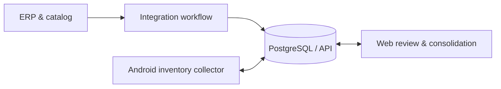

# Inventário Fácil
### Android Inventory Collection · Offline-first Workflows · Stock Reconciliation

> **Project showcase** — Inventory operations and business integrations

**The problem.** Counting physical inventory becomes slow and error-prone when operators rely on paper, manually re-enter quantities, or lose track of which stocktake they are working on.

**The solution.** Inventário Fácil combines a purpose-built Android collector with a central API, PostgreSQL persistence, and a web interface for inventory review and consolidation. It helps separate stock counting from administrative validation and inventory closeout.

## What I built / integrated

| Capability | Purpose |
| --- | --- |
| **Android collection** | Search by product code or barcode, enter quantities, manage one local draft, and continue an existing count offline. |
| **Synchronization** | Send collections to a central API when ready, while preserving meaningful local state. |
| **Web review** | Inspect received collections, review differences, validate counted items, and consolidate the stocktake. |
| **Inventory lifecycle** | Manage open and closed inventories, associate collections with the right inventory, and avoid accidental changes to prior counts. |
| **ERP data integration** | Synchronize relevant product and stock context through integration services rather than exposing the ERP directly to mobile devices. |

## Technology stack

**Kotlin · Jetpack Compose · Android · REST API · PostgreSQL · Docker · n8n · ERP integration**

## Simplified data flow

## Demonstrated milestone

A complete inventory workflow has been validated with a **physical Android device**, submission to the API, web validation, consolidated quantities, and web closeout. The source documentation distinguishes this confirmed cycle from features still awaiting hardening or further validation.

**Delivery note:** Export connectors and additional access-control hardening remain separate tasks; this showcase does not represent the platform as universally production-ready.

## My engineering focus

- Designing an offline-capable operational workflow.
- Integrating mobile, API, database, and browser-based operations.
- Preserving count integrity and inventory identity across synchronization.
- Distinguishing validated functionality from roadmap work.

**Source and data policy:** The implementation, customer inventory, product identifiers, screenshots with live data, and operational endpoints are not published here.

---

**[← Back to the GitHub portfolio](../README.md)** · [NiMa website](https://www.nimaautomacao.com.br) · [Business contact](mailto:contato@nimaautomacao.com.br)

NiMa Automação e Tecnologia · Public portfolio documentation · No private source code or client data
