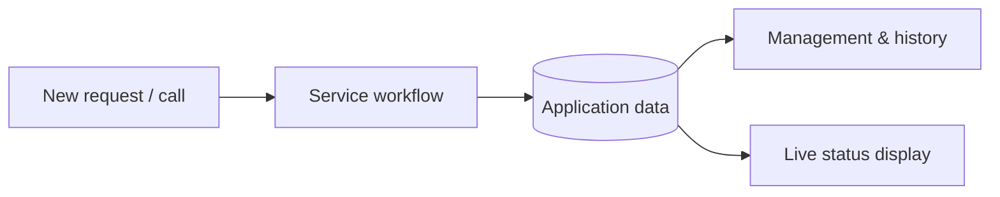

# Service Queue & Attendance Management
### Business Application · Real-time Status · Management Views

> **Project showcase** — Modernizing service coordination inside a business

**The problem.** Teams handling calls, requests, and internal service queues need shared visibility: what is waiting, what is being handled, who is responsible, and how progress is communicated to everyone involved.

**The approach.** A tailored web application for tracking service/attendance workflows, combining operator access, management views, history, and a screen-friendly real-time queue experience.

## Application areas represented in the project

| Area | Role |
| --- | --- |
| **Operator experience** | Business-facing application screens for day-to-day service workflows. |
| **Management** | Administrative and managerial views of service activity. |
| **History** | Dedicated history routes for reviewing previous activity. |
| **Display / TV view** | A large-screen display component intended for live attendance status. |
| **User access** | Authentication and user-related screens. |

## Technology stack

**TypeScript · Next.js · React · Supabase · JavaScript/TypeScript UI components · realtime integration**

## High-level workflow

## Why this project matters

It combines user interfaces for different audiences — operational staff, managers, and people watching a status display — within one business process. The private codebase contains dedicated app routes for management, history, user functions, and a TV view.

**Scope note:** The original private README still contains starter-template text; this case study is based on verified application structure and available project context. It does not claim customer adoption, production availability, or a quantified operational improvement.

**Confidentiality:** Company-specific data, internal configuration, and private source files are intentionally excluded.

---

**[← Back to the GitHub portfolio](../README.md)** · [NiMa website](https://www.nimaautomacao.com.br) · [Business contact](mailto:contato@nimaautomacao.com.br)

NiMa Automação e Tecnologia · Public portfolio documentation · No private source code or client data
