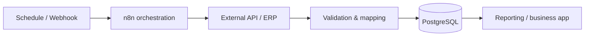

# Workflow Automation & System Integration
### Event-driven Processes · APIs · Reliable Operations

> **Project showcase** — Business automation through connected services

**The problem.** Independent business systems rarely share data or trigger follow-up actions in exactly the way teams need. Manual exports and repetitive checks are slow and difficult to audit.

**The approach.** Design targeted automation workflows that connect ERP data, APIs, PostgreSQL, reporting tools, and application services using n8n as an orchestration layer.

## Example workflow families

| Workflow | General purpose |
| --- | --- |
| **Catalog synchronization** | Retrieve product information and provide structured data to downstream applications. |
| **Stock synchronization** | Import stock data, validate a coherent snapshot, and make it available to reporting or business tools. |
| **Scheduled analytics** | Update sales and purchase reporting datasets. |
| **Application integrations** | Link API/webhook events with business application processes. |
| **Operational notifications** | Integrate status or failure signals with a notification channel when configured and tested. |

## Architecture

## Technology stack

**n8n · REST APIs · Webhooks · SQL · PostgreSQL · JavaScript · Docker · data integration**

## Reliability principles

**Idempotency:** Re-running a workflow should not silently duplicate records.

**Consistency:** Validate data integrity and isolate incomplete snapshots before publishing them.

**Observability:** Design for meaningful execution status, investigation of failures, and alerting where configured.

**Security:** Keep secrets in appropriate credential stores and document only their roles, not their values.

## Status

Real catalog, stock, and reporting workflows are documented and have been run in operational/test contexts. Reliability improvements for selected data synchronization and alerting paths are ongoing. No undisclosed workflow export, credential, endpoint, or client-specific payload is included here.

**This is an engineering case study, not a downloadable n8n workflow package.**

---

**[← Back to the GitHub portfolio](../README.md)** · [NiMa website](https://www.nimaautomacao.com.br) · [Business contact](mailto:contato@nimaautomacao.com.br)

NiMa Automação e Tecnologia · Public portfolio documentation · No private source code or client data
