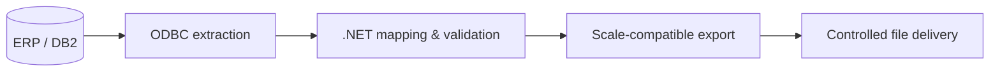

# NiMa Balança Sync
### Windows Desktop Integration · ERP Data · Retail Scale File Synchronization

> **Project showcase** — C#/.NET and legacy systems integration

**The problem.** Retail scales and older ERP environments often rely on precise, vendor-specific flat-file formats. Manually rebuilding product data or exporting files introduces formatting errors, outdated prices, and operational delays.

**The solution.** NiMa Balança Sync is an integration project connecting enterprise product information with the file formats expected by retail weighing software, with a Windows-oriented workflow for controlled generation and delivery.

## Technical responsibilities

| Area | Work |
| --- | --- |
| **Data access** | Connect to an IBM DB2-backed ERP through ODBC with separate configuration and controlled credential handling. |
| **Transformation** | Normalize product records, prices, validity fields, and label-related data into vendor-specific file formats. |
| **Format fidelity** | Validate character encoding, decimal precision, record length, and differences against reference exports. |
| **Windows integration** | Work with .NET/C#, PowerShell, desktop/service patterns, and network share delivery requirements. |
| **Regression checks** | Compare generated output with known-good baselines and validate changes when ERP data evolves. |

## Stack

**C# · .NET · WPF · Windows Service patterns · PowerShell · IBM DB2 · ODBC · SMB · retail scale file formats**

## Conceptual architecture

## Engineering highlight

A reference export format was tested using **byte-for-byte comparison**. This is especially important in industrial and retail integrations, where a visually correct text file may still fail because of encoding, separators, field widths, or decimal scaling.

**Development status:** Some export formats were validated against reference files while others were still under integration testing in the verified repository documentation. This is a technical showcase, not an unconditional claim of a completed production rollout.

**Privacy:** No ERP credentials, real product prices, customer files, internal network addresses, or source code are shared.

---

**[← Back to the GitHub portfolio](../README.md)** · [NiMa website](https://www.nimaautomacao.com.br) · [Business contact](mailto:contato@nimaautomacao.com.br)

NiMa Automação e Tecnologia · Public portfolio documentation · No private source code or client data
