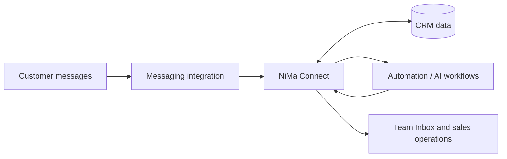

# NiMa Connect — CRM & Business Automation

> **Portfolio case study** · Business software · WhatsApp integrations · Workflow automation

**NiMa Connect** is a customized CRM platform designed to help businesses organize customer conversations, manage sales workflows, and connect communications with automation and AI-assisted tools.

This page is a **public technical case study, not the application source code**. The main product repository is private.

## The challenge

Customer support and sales teams often work across messaging apps, customer lists, manual follow-ups, and disconnected tools. This makes it harder to keep conversation context, assign work, and maintain consistent processes as teams grow.

NiMa Connect brings these workflows into an integrated environment, with an emphasis on practical business operations.

## What the solution covers

| Area | Scope |
| --- | --- |
| **Customer conversations** | A shared Inbox for messaging workflows and conversation history. |
| **Contacts and sales** | Contact management, pipeline views, and activity timelines. |
| **WhatsApp integration** | Connected messaging channels using an integration service and webhooks. |
| **Automation and AI** | Background processing, event-driven workflows, and configurable AI-assisted features. |
| **Organization management** | Organization-aware configuration, module availability, and role-based controls. |
| **Operations and quality** | Containerized environments, integration testing, and deployment validation. |

**Project status:** Active development and validation. Feature availability depends on configuration and deployment; this case study is not a claim that every module is generally available or in production.

## Technology stack

| Layer | Technologies |
| --- | --- |
| Application | **TypeScript**, **Next.js**, **React** |
| Data and authentication | **PostgreSQL**, **Supabase**, organization-aware data access |
| Messaging | **WhatsApp integration**, **WAHA**, webhooks |
| Processing and integrations | Background workers, **Redis**, REST APIs |
| Infrastructure | **Docker**, Linux, reverse proxy |
| Quality assurance | Automated tests, E2E validation, GitHub-based version control |

## High-level workflow

This diagram is intentionally simplified. It explains the business integration without exposing private infrastructure, security controls, or customer data.

## Engineering highlights

### Integrating messaging with customer context

The project connects incoming messages with CRM workflows so teams can work with conversations and customer records in one place. Messaging-channel connectivity and core Inbox flows have been exercised in the development/validation environment.

### Multi-organization design

The platform uses organization-aware access patterns. NiMa-specific work includes organization-level module configuration and administrative controls, with data-access restrictions considered as part of the implementation and testing.

### Reliable background processing

The engineering work includes event-driven processing and regression testing for cases such as closely spaced incoming messages. These checks matter because messaging automations should not generate duplicate customer replies.

### Practical deployment and validation

The system has been assembled and tested in a containerized environment, including application services, messaging integration, worker processes, and supporting components. Functional checks and automated test suites are part of the development workflow.

## My contribution

Through **NiMa Automação e Tecnologia**, I work on adapting the CRM to real business needs, connecting messaging and automation workflows, validating functionality, and operating the supporting application environment.

NiMa Connect is a customized solution built upon an **existing open-source CRM foundation**, with additional product adaptations, integrations, deployment work, and ongoing validation. It is not presented as a from-scratch implementation of every underlying CRM feature.

## Privacy and availability

- The product source repository is **private**.
- Client details, credentials, internal addresses, and production data are **not published**.
- No public demonstration environment or unrestricted test account is offered through this page.
- Selected, sanitized screenshots or a guided demonstration may be added separately when approved.

## Discuss a similar project

I work on business software, CRM customization, integrations, automation, and deployment.

**Website:** [NiMa Automação e Tecnologia](https://www.nimaautomacao.com.br)  
**Email:** [contato@nimaautomacao.com.br](mailto:contato@nimaautomacao.com.br)  
**GitHub profile:** [@nivcam](https://github.com/nivcam)

---

[← Back to GitHub portfolio](../README.md)

*NiMa Automação e Tecnologia · Technical case study · October 2026*
